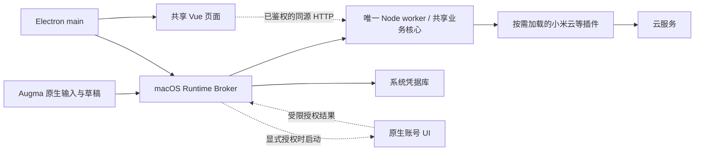
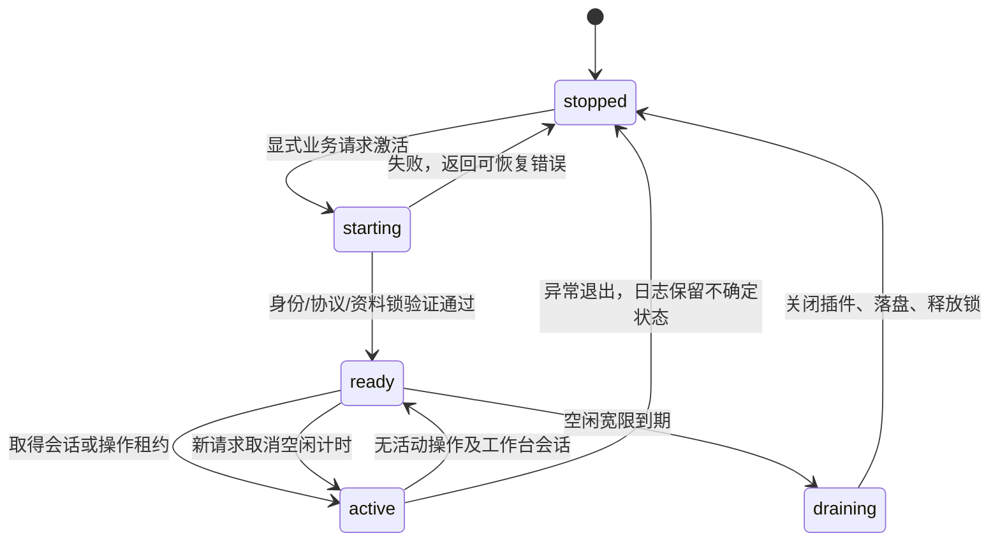

# 按需共享运行时：模块、进程与账号设计

日期：2026-11-04。状态：P0/P1 已有仅用于隔离验收的实现，见下方进度；共享登录、生产客户端切换和小米云写入待实施。依据 [ADR 0015](../adr/0015-use-an-on-demand-shared-runtime-for-cloud-capture.md)。

## 当前实施进度

- `packages/craft-hub/src/shared-capture-runtime.ts` 提供独占所有者、延迟加载、准备/提交/回执和持久日志；`runtime-availability.ts` 提供会话/操作等租约与单一空闲计时器。
- 独立 Node 入口（`apps/runtime/README.md`）只加载本机假插件，无真实网络或凭据。既有 Electron 工作台仍使用原宿主；完整工作台的组合与观察升降级属于 P2，不能让两个宿主同时打开同一资料。
- macOS Broker（`apps/runtime-macos/README.md`）已实现双向 XPC 签名约束、`SMAppService` 注册 Adapter、单 worker 启动合并、EOF 清理和空闲退出。注册只在显式验收中针对临时 App 执行。
- `pnpm test:shared-runtime` 使用隔离 Electron 和原生客户端验证启动竞争、发送期间客户端退出、控制进程/worker 崩溃、未知结果不重发和空闲释放；JSON 证据保留在脚本输出的忽略目录。开发签名成功不等于 Developer ID 分发或所有最低系统已验收。
- 真实 Augma Adapter、客户端配对/权限、系统凭据、统一登录、小米创建与生产安装更新仍按 P2–P5 推进。当前仅公布 `fixture.capture` 能力。

目标场景：Electron 完全退出后，用户在 Augma 选择已连接的小米账号、输入笔记、确认发送，直接获得云端回执。未连接、断网或结果未知时保留草稿并显示真实状态。空闲时 Node、运行时控制进程和登录窗口均释放；Augma 的常驻界面保持独立可用。

## 1. 模块分工与进程

| Module | 拥有的行为与状态 | Interface / 实现落点 |
| --- | --- | --- |
| 共享业务核心 | 发现、信任、执行、业务配置、写入审阅、提交日志和回执 | 继续在 `packages/craft-hub`；供应商实现仍通过 Adapter 接入 |
| 共享运行时宿主 | 组合已启用插件、按需加载能力、管理 Provider Connection、会话和关闭顺序 | 从 `apps/desktop/src/host-runtime.ts` 抽取为拟议的 `apps/runtime`；Electron 与后台入口使用同一组合逻辑 |
| macOS Runtime Broker | 操作系统客户端身份校验、运行时发现/启动、租约、版本协商、系统凭据 Adapter | 拟议 `apps/runtime-macos` 中的 Swift 可执行目标；用户级 Launch Agent，按消息启动，不需要 root |
| Node worker | 同一资料范围唯一的业务执行者；插件网络访问、数据和回执写入 | 使用随 Craft Hub 打包且校验过的独立 Node；不依赖 Electron 进程或用户 PATH |
| 原生账号 UI | 隔离登录窗口、受限 Cookie 提取和系统交互 | 同一 macOS 包中的独立、短命 `.app`；复用现有登录视图和策略校验，不依赖完整 `WorkbenchModel` |
| Electron + Vue | 完整工作台、管理插件/连接、业务页面、显示审阅结果 | Electron main 通过客户端 Adapter 连接 worker；Vue 继续消费已有同源 HTTP 合同 |
| Augma | 菜单栏、输入、可恢复草稿、目标选择、确认与结果呈现 | 复用 `WorkspaceStore`、`CaptureSending` 和现有未知回执交互；增加共享目标 Adapter |
| 供应商插件 | 对应云服务的协议、能力声明、账号校验、读取和创建 | 小米逻辑只在 `packages/craft-hub-plugin-xiaomi-cloud` 扩展；不在 Augma 再写一份 |

单个资料范围的普通小米发送新增 Broker 和一个 Node worker 两个临时进程；只有登录时才增加账号 UI 及其 WebKit 子进程。其他插件可能有自己的受控子进程，均纳入资源验收。进程数量和内存收益需实测，不能因为用了原生控制层就假定更省内存。账号 UI 不放进 Launch Agent；它通过正常用户会话按需显示，完成或取消后退出。

Craft Hub 是运行时安装与升级的所有者。Augma 首次连接时选择一个已安装的 Craft Hub 发行版和资料身份；配对后直接使用其已注册入口。未安装、后台项被禁用或首次设置尚未完成时，说明状态并提供设置入口，保留本机草稿；不静默下载另一套后端。Augma 的备忘录等独立本机功能继续可用。

macOS 候选控制方案为 `SMAppService` 注册用户级 Launch Agent，以 Mach service / XPC 请求激活，`KeepAlive` 关闭且不设周期启动。注册服务不等于进程常驻。Electron 需要薄的原生 XPC Adapter；Augma 使用 Swift Adapter；worker 使用私有父子管道。不同语言可各有序列化实现，但插件、登录策略和业务规则只有一份。该 OS Adapter 先经过真实签名、双应用连接及权限验证，再作为可分发实现。

初版只配对一个明确选定的资料范围，不扫描或预热其他资料。Broker 为这个范围路由和合并请求，不另建跨资料账号池；未来若支持多个范围，各自保持独占 worker，最后一个活动范围排空后 Broker 才退出。

## 2. 唯一所有者与资料范围

- 运行时身份由 OS 用户、发行版和规范化的数据/配置根目录共同确定。任何可写根目录重叠都不能出现两个所有者；不能只凭随机端口或 PID 文件判断占用。
- 现有 `ProfileLease` 的普通 `client` 模式是共享读取锁，不能直接充当独占运行时锁。计划在同一锁身份上增加独占的 `runtime-owner` 模式，与旧 `client` 和 `migration` 均互斥。连接型客户端不再自行打开业务资料；旧内嵌宿主占用时必须拒绝启动，而不是另开端口继续写入。
- P0/P1 已增加 `runtime-owner` 和祖先意向锁，当前代码的父/子可写根也互斥。旧发行版只持有其原有精确根锁；升级时继续使用既定资料根，不在旧进程存活时改成其父/子目录，也不借此绕过未完成的身份迁移。
- Broker 对同一资料的并发启动合并为一次；worker 在打开业务存储之前取得所有者租约。退出时最后释放，启动/关闭失败也按同一顺序清理。现有迁移保护继续生效。
- Electron 切换到共享模式后不再调用另一份 `createDesktopHostRuntime`。CLI 或浏览器入口若访问同一活动资料，也必须接入所有者，或明确报告占用；不能绕过互斥。
- 保留 `apps/macos` 原生候选、其隔离资料和备份。本文不切换公开链接、不合并资料目录，也不改变项目的显式信任和 `command + args`、`shell: false` 执行合同。

## 3. 进程生命周期与资源释放

| 租约 | 起点与终点 | 对进程的影响 |
| --- | --- | --- |
| 工作台会话 | Electron 工作台连接就绪到其会话关闭/进程退出 | 保留完整 API、必要事件流及项目观察；初版不承诺仅关窗就卸载仍在使用的网页会话 |
| 操作租约 | 一次目标查询、预览、提交或回执读取开始，到完成/失败/有界超时 | Augma 操作结束立即归还；输入、展示缓存及空闲 XPC 连接本身不持有租约 |
| 执行租约 | 安装、PTY、命令或其他已接受后台任务开始，到真实结束 | 客户端断开不等于任务结束；进程不能因 UI 消失而被杀 |
| 交互授权租约 | 用户主动开始登录，到成功、取消或到期 | 只在可见且有期限的授权流程中保留；不同客户端的同一连接授权合并，不重复弹窗 |

初始建议值为：启动期限 15 秒、无租约空闲宽限 30 秒、普通云请求期限 30 秒、清理期限 5 秒、交互授权期限 5 分钟。这些是待测量的策略参数，不是已验证的性能指标。超时策略按读、写、授权分别处理；超过授权期限前可由用户明确继续，不能无限隐式续期。

具体规则：

1. 打开 Augma、展开菜单、编辑草稿和读本机摘要不启动 worker；选择共享目标、主动刷新、发送或重连账号时才激活。worker 先启用所需插件，捕获用途不启动项目 watcher、文件索引、PTY、AI、个人云或不相关连接器。
2. 复用同一核心，但要拆开当前 `startCraftHubServer` 的项目 watcher 和定时配置刷新。`capture` 与 `workbench` 是内部激活范围，不是两份运行时；工作台会话到来时提升能力，离开时释放相关观察。
3. 发送被接受后，其操作租约由运行时持有。Augma 或 Electron 断开，只释放客户端会话；不能中断已发出的云写入，也不能把它报告为取消成功。新的同号请求只能读取该尝试的状态。
4. 没有租约后设一个空闲定时器；新请求取消它。进入 `draining` 后拒绝新写入，调用方等待有界重连。不要用心跳、固定轮询、保持空闲连接或定期重启来阻止退出。
5. 清理顺序：关闭观察和新请求入口 → 等待有界在途操作并落盘 → 关闭所有已加载插件传输、子进程与登录会话 → 关闭 HTTP/管道 → 释放所有者租约 → worker 和 Broker 退出。现有 To Do 连接器的 2/10 分钟局部空闲策略不能阻止更早的整体退出。
6. 结果未知但已落盘的尝试不永久占用租约；worker 可以空闲退出。下次只恢复状态查询/核对，不能自动重放写入。进程崩溃后由下一次用户请求重新激活，避免无业务需求的重启循环。
7. 登出、安装更新、迁移和用户要求退出全部后台能力，都先询问运行时的真实活动与日志状态。更新只在可安全排空时切换版本；不能用 Electron 自己的 pending 布尔值代替所有客户端的操作状态。
8. Broker 异常退出时，worker 检测私有管道 EOF 并有界排空，保存无法确认的尝试后退出，不能留下无限驻留的孤儿进程。worker 崩溃时 Broker 结束对应租约并返回可恢复状态；重启后的日志将未确认的 `dispatching` 记录恢复为 `uncertain`，不自动重发。

## 4. 账号、登录与授权归属

| 内容 | 唯一所有者 | 客户端能获得什么 |
| --- | --- | --- |
| 云账号连接与插件版本/能力 | 共享运行时的连接管理 | 稳定、不透明的连接 ID、遮罩后的账号标签、连接 revision 和可用能力 |
| Cookie、refresh token 等凭据 | 系统凭据库，经 Broker 的受限 Adapter 读写 | 可用/失效状态；不返回原始值、凭据文件或任意 Keychain 读取接口 |
| 供应商登录状态机、允许来源及 Cookie 名称 | 供应商插件与共享连接管理 | 有期限的授权会话 ID 和声明式提示 |
| 登录浏览器和系统确认窗口 | 同一份原生账号 UI | 登录结果；第三方网页无桌面桥接，凭据经私有通道交回运行时 |
| 可编辑草稿 | 发起记录的客户端 | Augma 自己的恢复文档；不要求两个客户端同时编辑同一草稿 |
| 已接受的 Capture Attempt 与回执 | 共享运行时的持久日志 | 该尝试的状态、错误分类及已确认的远端笔记 ID |

连接引用绑定 `profileId + providerId + connectionId + accountId + origin/region + revision`；外部界面不必展示所有字段，但审阅和提交必须逐项匹配。重登、账号切换、换区、断开连接、插件能力变化都使旧审阅失效，向两个客户端同步状态。单个客户端退出不登出云账号；释放内存会话也不删除系统凭据，下次读取同一连接即可继续。

Augma 自身账号、Craft Hub 的项目 Owner Scope 与供应商云账号是不同身份，不能互相替代。断开 Augma 配对只撤销该客户端的共享访问；明确选择“登出小米账号”才处理共享凭据并影响所有使用该连接的客户端。登出前展示真实在途尝试，已发出的请求不能因删除本机凭据就假定已撤销。重新连接时仍须选择明确账号，不把默认账号变化静默套到旧草稿。

首次配对验证实际 XPC 客户端身份及已安装运行时来源，并取得限定的目标/能力授权。`hostKind`、同一 UID、bundle ID 字符串或旧 Agent 项目只读 token 均不足以授予云写入。正式版校验签名身份与审阅过的客户端范围；开发签名和无签名环境单列验收，不静默扩大权限。授权结果不放进深链接、参数、共享 JSON、剪贴板或日志。

复用现有小米 `XiaomiCredentialStore` 的注入位置，把系统操作接到共享 Adapter；插件仍在私有 worker 内短暂取得其网络请求所需会话。现有服务名包含 `dataDir` 的哈希：只有同一资料身份才能复用既有记录。原生候选资料与 Electron 资料不能自动互认；若需要使用候选中的账号，走显式审阅的转移或一次重新登录，保持原备份和草稿完整。相同签名团队也不自动证明跨可执行文件的 Keychain 访问已经通过。

Augma 现有 Microsoft 登录/发送路径先保留原状态，待共享目标完整验收后按目标迁移；新小米能力只接共享路径。原生备忘录仍由本机 Adapter 承担。不要为了统一云连接器而重写原生系统操作，也不向 Augma 引入另一套插件安装、供应商 SDK 或 Cookie 表单。

## 5. 最小 Interface 与发送流程

| Interface 范围 | 最小请求/结果 | 约束 |
| --- | --- | --- |
| 启动与诊断 | `hello` / `doctor`：协议范围、运行时构建、资料身份、可用能力、安装/凭据/连接状态 | 握手和故障诊断不执行云写入，不自动授权；不兼容时明确失败 |
| 目标与连接 | `capture.targets`、`connection.status`、`connection.authorize` | 目标关联已启用插件及所选账号；只有用户操作能开始登录 |
| 审阅 | `capture.prepare` 返回规范化内容、目标说明、警告和短期审阅凭据 | 绑定内容指纹、客户端、连接 revision、目标和期限；不调用创建笔记 |
| 提交 | `capture.commit` 接收客户端预先保存的 `attemptId` 和审阅凭据 | 先持久化接受/发送状态，再执行受限插件创建；同号重复请求不重发，同号不同内容/目标直接拒绝 |
| 回执 | `capture.receipt` 返回接受、发送中、成功、发出前失败或结果未知 | 请求和 worker 重启不丢失身份；查询本身没有写入副作用 |

这里是限定的捕获 Interface，不提供任意工具调用、shell、路径写入或通用凭据读取。协议 schema 和契约样例有一个权威来源，TS/Swift Adapter 通过共同样例验证；不要求两端共享同一 UI 框架。Vue 的既有同源 HTTP/session 合同继续使用；Broker 只向已鉴权的 Electron main 交付有期限的网页引导信息。Augma 的捕获不经通用网页桥接，旧网页会话不能跨 worker generation 复用。

发送顺序：

1. Augma 先保存完整草稿及稳定 `attemptId`。解析/预览不意味着发送；客户端展示当前目标账号与内容。
2. 激活 Broker，协商协议和资料身份，取得短期操作租约。已有兼容 worker 就复用；并发双客户端也只产生一个所有者。
3. 读取目标与连接状态。失效时经同一账号 UI 完成授权；用户取消或网络失败都保留草稿。
4. `prepare` 后用户确认当前内容。若目标、内容或连接 revision 变化，重新审阅；不能把原始内容静默发送到刚切换的账号。
5. worker 在共享日志中原子持久化账号/目标、内容指纹、审阅身份和 `dispatching` 状态，完成所用存储要求的落盘屏障后才调用插件。日志不存原始凭据；确有必要的内容保留使用本机受限存储，不进入便携配置。
6. 取得有效远端 ID/回执并持久化后返回成功。Augma 才把本机待发送项标为已交付；无法保存本机回执时保留尝试 ID，恢复后查回执而非再创建一次。
7. 超时、断线或崩溃无法确认结果时记为 `uncertain`。本机 attempt ID 只防本机重复，不能证明云服务有幂等能力。小米未验证幂等键之前不承诺 exactly-once；搜索不到也不等于确定未创建，未知尝试不得自动补发。
8. 归还操作租约，启动空闲释放。网络不可用时显示“已保存到本机，尚未发送”；网络恢复不隐式把未知请求重新上传。

## 6. 当前代码与待补工作

下表也记录开发工作区中单独推进的候选实现（小米读取插件、原生登录窗口及 Augma 摘要）；它们不属于本次 P0/P1 合并，也不是假插件验证的依赖。

| 现有实现 | 可复用内容 | 必须调整的地方 |
| --- | --- | --- |
| `apps/desktop/src/host-runtime.ts` | 插件组合、按需导入、连接关闭、配置范围 | 抽取独立宿主；增加捕获用途的最小激活范围 |
| `apps/desktop/src/sidecar.ts` | 管道鉴权、单次引导、固定 Node 合同 | 现入口跟随父宿主 stdin 结束；新 worker 生命周期必须跟随 Broker/租约，不能简单 detached 后遗留原 EOF 行为 |
| `packages/craft-hub/src/profile-lease.ts` | 规范化目录、内核锁、迁移互斥与持久保护 | 新增独占运行时模式，验证旧客户端、CLI、迁移和版本切换的竞争 |
| `apps/macos/Sources/CraftHubMac/ConnectionBrowserBridge.swift` 与 `apps/macos/Sources/CraftHubMacCore/ConnectionBrowserAuthorization.swift` | 最新声明复核、来源/账号隔离、受限 Cookie 提取 | 抽离完整工作台依赖，接统一账号 UI；旧候选本体保留 |
| 小米插件 `storage.ts` / `transport.ts` | 系统凭据注入、按账号备份、来源限制、请求中止 | 当前只读。新增文本创建必须单独验证接口、错误和回执；不能把本地备份动作改成云写入 |
| Augma `QuickCaptureStore` / `WorkspaceFile` / `CaptureSending` | 先落盘、目标绑定、未知结果阻止重发、重启恢复 | 增加共享目标和远端尝试引用；共享路径不再调用本机 Microsoft 登录实现 |
| 当前摘要 JSON | 版本化、只读、可离线展示 | 继续作为缓存，不承载提交、账号权限或已交付事实；本轮不为临时桥接强加长期兼容负担 |

## 7. 实施顺序和验收门槛

| 阶段 | 可交付结果 | 完成条件 |
| --- | --- | --- |
| P0：协议与 macOS 控制试验 | `hello` / `doctor`、XPC 身份、注册/禁用状态、独占所有者 | Electron 与 Augma 并发连接只启动一个 worker；无业务请求时不启动；真实签名与服务批准验证 |
| P1：共享核心与生命周期 | 捕获/工作台范围、租约、空闲退出、可恢复日志 | 使用假插件验证退出、崩溃、启动竞争、EOF、取消、迟到响应和未知回执；不访问真实云账号 |
| P2：Electron 接入唯一所有者 | 主界面消费同一 worker，完整工作台能力保留 | 去除该模式的内嵌第二运行时；工作台、CLI、更新、迁移、信任/执行和跨客户端活动保护通过 |
| P3：共享连接与 Augma Adapter | 单份登录 UI/凭据访问，Augma 准备/提交/查回执 | Cookie 不进两个界面；账号切换、注销、Keychain 提示、取消与草稿恢复真实走查；旧连接显式转移 |
| P4：小米文本创建闭环 | 经验证的供应商创建及回执 | 在明确选定的测试账号/目标中创建一条测试笔记并读回；验证中文/emoji、登录失效、超时/限流和未知结果。未通过前不声明 `createTextNote` 可用 |
| P5：跨应用与资源验收 | Electron 完全退出后的云端记录及空闲回收 | Electron 启动/退出、Augma 重启、双客户端并发、写入时退出、断网恢复、更新竞争实测；记录全部进程身份并清理临时实例 |

资源验收用相同机器、账号范围和数据，区分首次启动、连续发送和关闭后静置。分别记录本机输入到可编辑、按发送到回执的 p50/p95（分开记录网络耗时）、全进程 footprint、空闲 CPU、唤醒次数、后台请求数，以及实际插件子进程。目标是没有租约且宽限/清理完成后 Broker、worker、插件子进程和登录 WebKit 都退出；仅打开缓存不重新激活。权限提示或明确的活动任务等待须单独标记，不能伪装成空闲。

本批交付隔离的 P0/P1 验证实现。真实小米写入接口、分发版后台注册、Developer ID 签名/Keychain 访问、当前 Augma 的 macOS 26 最低系统、跨版本升级与资源指标均是后续验收项。生产资料和凭据未自动迁移；未发版接口可直接收敛，数据与凭据仍须保留和审阅。

## 参考

- Apple [Creating Launch Daemons and Agents](https://developer.apple.com/library/archive/documentation/MacOSX/Conceptual/BPSystemStartup/Chapters/CreatingLaunchdJobs.html)：用户级按需启动、端口激活及退出后重新启动；具体注册采用现代 `SMAppService`。
- Apple [SMAppService](https://developer.apple.com/documentation/servicemanagement/smappservice)：管理 App 内的后台辅助程序及其授权状态。
- Apple [Designing Daemons and Services](https://developer.apple.com/library/archive/documentation/MacOSX/Conceptual/BPSystemStartup/Chapters/DesigningDaemons.html)：后台进程职责、跨应用通信及 UI 进程的分工；不把交互登录直接放进 Launch Agent。
- Apple [NSXPCConnection signing requirement](https://developer.apple.com/documentation/foundation/nsxpcconnection/setcodesigningrequirement(_:))：对实际 XPC 对端约束代码签名，避免仅以 PID 或路径判断身份。
- SQLite [synchronous](https://sqlite.org/pragma.html#pragma_synchronous)：捕获日志采用 DELETE journal + EXTRA，并同步新建目录；外部发送前完成本机日志落盘。
